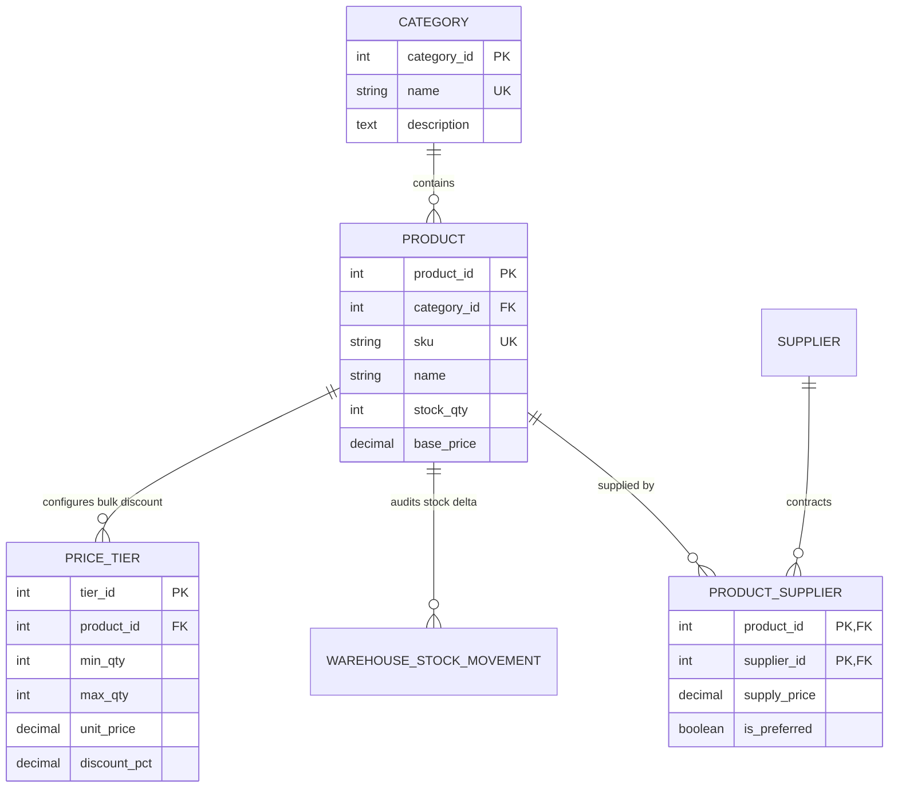
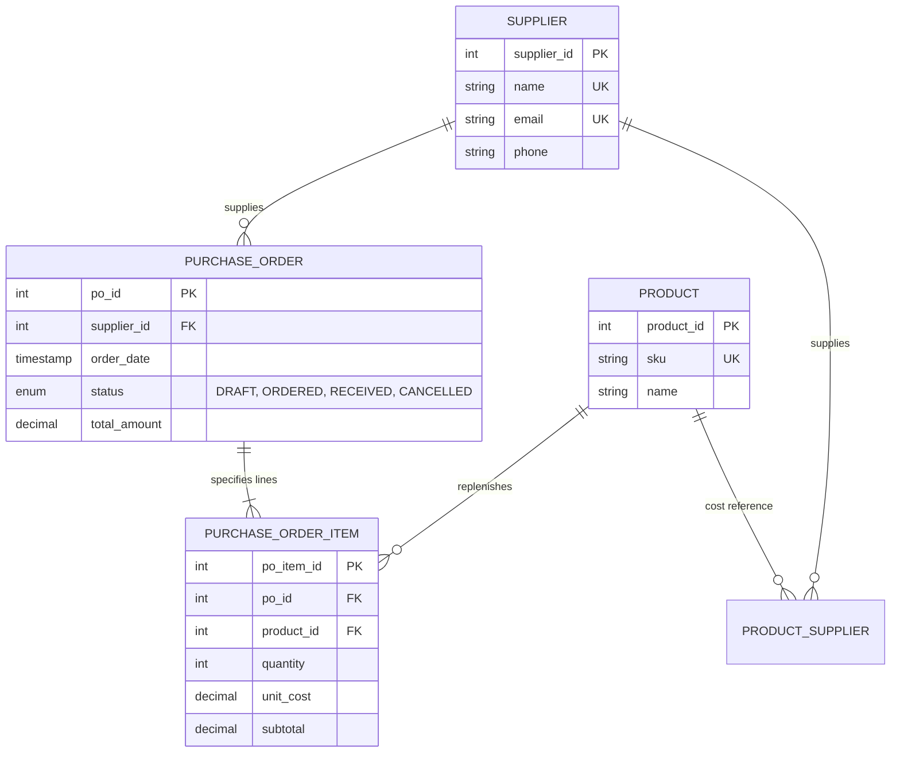
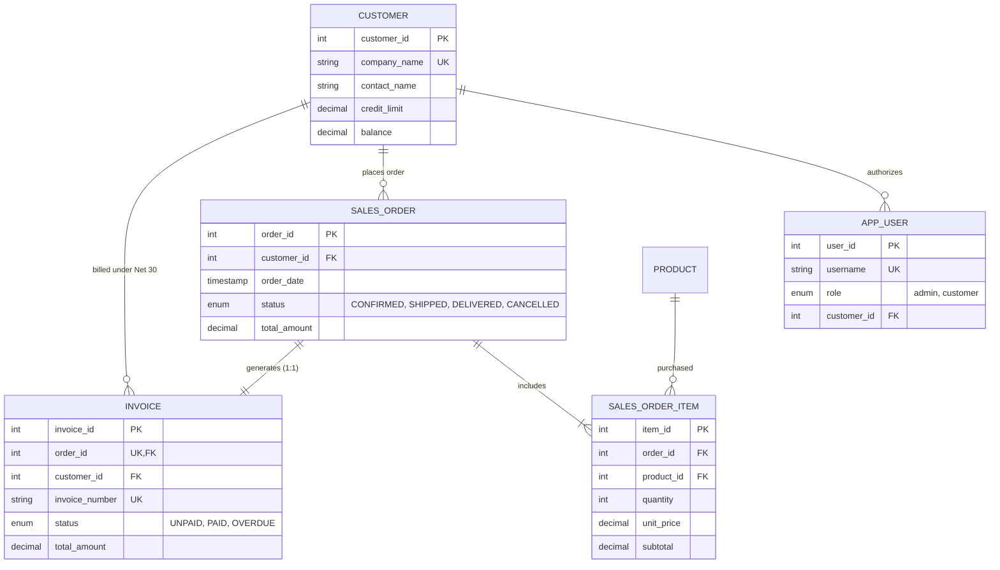
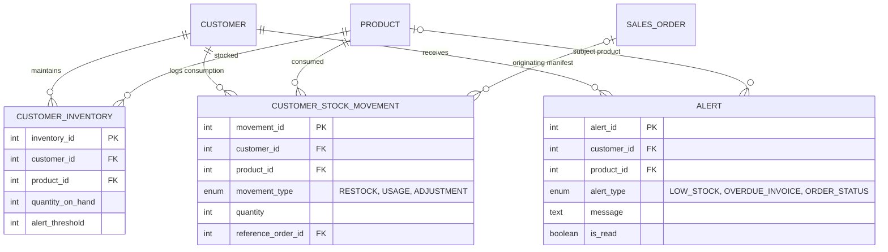

# Entity-Relationship (ER) Diagrams: Wholesale Management System
**Course:** CSC2103 - Relational Database Management Systems  
**Database:** MySQL 8.0+ (InnoDB Storage Engine)  
**Total Tables:** 16 Relational Entities  

---

## 1. Complete System Entity-Relationship Diagram (ERD)

The diagram below captures all **16 normalized tables**, their primary keys (`PK`), foreign keys (`FK`), and cardinalities using Crow's Foot notation.

```mermaid
erDiagram
    %% Core Entities
    CATEGORY ||--o{ PRODUCT : "classifies"
    PRODUCT ||--o{ PRICE_TIER : "has volume discounts"
    SUPPLIER ||--o{ PRODUCT_SUPPLIER : "supplies"
    PRODUCT ||--o{ PRODUCT_SUPPLIER : "supplied by"
    
    %% Procurement Flow
    SUPPLIER ||--o{ PURCHASE_ORDER : "receives"
    PURCHASE_ORDER ||--|{ PURCHASE_ORDER_ITEM : "contains"
    PRODUCT ||--o{ PURCHASE_ORDER_ITEM : "ordered in"

    %% Customer & Auth
    CUSTOMER ||--o{ APP_USER : "has login account"
    CUSTOMER ||--o{ SALES_ORDER : "places wholesale orders"
    
    %% Sales & Billing Flow
    SALES_ORDER ||--|{ SALES_ORDER_ITEM : "contains"
    PRODUCT ||--o{ SALES_ORDER_ITEM : "purchased as"
    SALES_ORDER ||--|| INVOICE : "generates Bill of Lading"
    CUSTOMER ||--o{ INVOICE : "billed to"

    %% Retailer Store Inventory & Ledger
    CUSTOMER ||--o{ CUSTOMER_INVENTORY : "tracks store stock"
    PRODUCT ||--o{ CUSTOMER_INVENTORY : "stocked by customer"
    CUSTOMER ||--o{ CUSTOMER_STOCK_MOVEMENT : "logs consumption"
    PRODUCT ||--o{ CUSTOMER_STOCK_MOVEMENT : "consumed"
    SALES_ORDER |o--o{ CUSTOMER_STOCK_MOVEMENT : "restocked from"

    %% Central Warehouse Audit & Alerts
    PRODUCT ||--o{ WAREHOUSE_STOCK_MOVEMENT : "audited by"
    CUSTOMER ||--o{ ALERT : "notified by"
    PRODUCT |o--o{ ALERT : "triggers alert for"

    %% Table Definitions with Attributes
    CATEGORY {
        int category_id PK
        string name UK
        text description
        timestamp created_at
    }

    SUPPLIER {
        int supplier_id PK
        string name UK
        string contact_name
        string email UK
        string phone
        text address
        timestamp created_at
    }

    CUSTOMER {
        int customer_id PK
        string company_name UK
        string contact_name
        string email UK
        string phone
        text shipping_address
        decimal credit_limit
        decimal balance
        timestamp created_at
    }

    APP_USER {
        int user_id PK
        string username UK
        string password_hash
        enum role "admin, customer"
        int customer_id FK "nullable"
        timestamp created_at
    }

    PRODUCT {
        int product_id PK
        int category_id FK
        string sku UK
        string name
        text description
        string unit_of_measure
        int min_order_qty
        int stock_qty
        int reorder_threshold
        decimal base_price
        boolean is_active
        timestamp created_at
    }

    PRICE_TIER {
        int tier_id PK
        int product_id FK
        int min_qty
        int max_qty "nullable"
        decimal unit_price
        decimal discount_pct
    }

    PRODUCT_SUPPLIER {
        int product_id PK, FK
        int supplier_id PK, FK
        string supplier_sku
        decimal supply_price
        int lead_time_days
        boolean is_preferred
    }

    PURCHASE_ORDER {
        int po_id PK
        int supplier_id FK
        timestamp order_date
        enum status "DRAFT, ORDERED, RECEIVED, CANCELLED"
        decimal total_amount
        timestamp received_date
        text notes
    }

    PURCHASE_ORDER_ITEM {
        int po_item_id PK
        int po_id FK
        int product_id FK
        int quantity
        decimal unit_cost
        decimal subtotal
    }

    SALES_ORDER {
        int order_id PK
        int customer_id FK
        timestamp order_date
        enum status "PENDING, CONFIRMED, SHIPPED, DELIVERED, CANCELLED"
        decimal subtotal
        decimal tax_amount
        decimal total_amount
        text shipping_address
        text notes
        timestamp created_at
    }

    SALES_ORDER_ITEM {
        int item_id PK
        int order_id FK
        int product_id FK
        int quantity
        decimal unit_price
        decimal subtotal
    }

    INVOICE {
        int invoice_id PK
        int order_id UK, FK
        int customer_id FK
        string invoice_number UK
        timestamp invoice_date
        timestamp due_date
        decimal total_amount
        enum status "UNPAID, PAID, OVERDUE"
        timestamp paid_date
    }

    CUSTOMER_INVENTORY {
        int inventory_id PK
        int customer_id FK
        int product_id FK
        int quantity_on_hand
        int alert_threshold
        timestamp last_restocked_at
        timestamp updated_at
    }

    CUSTOMER_STOCK_MOVEMENT {
        int movement_id PK
        int customer_id FK
        int product_id FK
        enum movement_type "RESTOCK, USAGE, ADJUSTMENT"
        int quantity
        int reference_order_id FK "nullable"
        string notes
        timestamp created_at
    }

    WAREHOUSE_STOCK_MOVEMENT {
        int movement_id PK
        int product_id FK
        enum movement_type "IN_PURCHASE, OUT_SALE, RETURN_CANCEL, ADJUSTMENT"
        int quantity
        int reference_id "nullable"
        string notes
        timestamp created_at
    }

    ALERT {
        int alert_id PK
        int customer_id FK
        int product_id FK "nullable"
        enum alert_type "LOW_STOCK, OVERDUE_INVOICE, ORDER_STATUS, GENERAL"
        text message
        boolean is_read
        timestamp created_at
    }
```

---

## 2. Subsystem ER Diagrams (Modular Architecture)

For lab viva, project reports, and modular architectural analysis, the schema is decomposed into 4 cohesive sub-domains:

### Subsystem 1: Catalog, Products & Multi-Tier Pricing
Focuses on warehouse catalog categorization, inventory thresholds, and automated bulk volume discount schedules.

---

### Subsystem 2: Procurement & Inbound Supply Chain
Handles supplier relationships, wholesale replenishments, and warehouse restock orders.

---

### Subsystem 3: Wholesale B2B Sales, Credit & Invoicing
Manages business customers, authorized accounts, sales order manifests, and legal Bills of Lading / Tax Invoices.

---

### Subsystem 4: Retailer Local Inventory & Real-Time Alert Engine
Tracks secondary stock held at customer retail stores, records sales consumption, and triggers automated low-stock warnings.

---

## 3. Relational Mapping & Cardinality Matrix

| Parent Table | Child Table | Foreign Key Column | Cardinality | Action on Delete | Business Meaning |
| :--- | :--- | :--- | :---: | :---: | :--- |
| `category` | `product` | `category_id` | **1 : N** | `RESTRICT` | Each product belongs to exactly 1 category; categories cannot be deleted if products exist. |
| `product` | `price_tier` | `product_id` | **1 : N** | `CASCADE` | Volume discounts automatically removed if the parent product is deleted. |
| `supplier` | `product_supplier` | `supplier_id` | **1 : N** | `CASCADE` | M:N decomposition between suppliers and wholesale catalog products. |
| `product` | `product_supplier` | `product_id` | **1 : N** | `CASCADE` | Product can have multiple suppliers with distinct cost prices and lead times. |
| `supplier` | `purchase_order` | `supplier_id` | **1 : N** | `RESTRICT` | Inbound restocking orders issued to verified suppliers. |
| `purchase_order` | `purchase_order_item` | `po_id` | **1 : N** | `CASCADE` | Individual item lines belonging to a supplier procurement order. |
| `product` | `purchase_order_item` | `product_id` | **1 : N** | `RESTRICT` | Products referenced in active restocking purchase orders. |
| `customer` | `app_user` | `customer_id` | **1 : N** | `SET NULL` | Associates web portal user credentials to specific business accounts. |
| `customer` | `sales_order` | `customer_id` | **1 : N** | `RESTRICT` | Wholesale customer placing bulk purchase orders. |
| `sales_order` | `sales_order_item` | `order_id` | **1 : N** | `CASCADE` | Line items staged on a customer sales manifest. |
| `product` | `sales_order_item` | `product_id` | **1 : N** | `RESTRICT` | Stock items reserved and deducted upon order confirmation. |
| `sales_order` | `invoice` | `order_id` | **1 : 1** | `CASCADE` | Unique commercial Bill of Lading & tax invoice per confirmed order. |
| `customer` | `invoice` | `customer_id` | **1 : N** | `RESTRICT` | Customer financial ledger and revolving Net 30 balance tracking. |
| `customer` | `customer_inventory` | `customer_id` | **1 : N** | `CASCADE` | Store inventory records owned by a retailer. |
| `product` | `customer_inventory` | `product_id` | **1 : N** | `RESTRICT` | Specific catalog goods received and stored at the retail shop. |
| `customer` | `customer_stock_movement` | `customer_id` | **1 : N** | `CASCADE` | Retailer audit trail of usage, retail sales, or restocks. |
| `product` | `customer_stock_movement` | `product_id` | **1 : N** | `RESTRICT` | Item SKU involved in a retail store stock event. |
| `sales_order` | `customer_stock_movement` | `reference_order_id`| **1 : N (Optional)**| `SET NULL` | Links automated restock entries to the originating delivery order. |
| `product` | `warehouse_stock_movement`| `product_id` | **1 : N** | `RESTRICT` | Warehouse central depot audit log (purchases in, sales out). |
| `customer` | `alert` | `customer_id` | **1 : N** | `CASCADE` | In-app notification messages delivered to a customer terminal. |
| `product` | `alert` | `product_id` | **1 : N (Optional)**| `SET NULL` | Contextual product related to low-stock notifications. |
