# Entity-Relationship (ER) Diagram & Relational Mapping

**Course:** CSC2103 - Relational Database Management Systems  
**Institution:** Manipal University Jaipur, Department of Computer Science & Engineering  
**Project:** Wholesale Management System  

---

## 1. Mermaid Entity-Relationship Diagram

```mermaid
erDiagram
    CATEGORY ||--o{ PRODUCT : contains
    SUPPLIER ||--o{ PURCHASE_ORDER : supplies
    SUPPLIER ||--o{ PRODUCT_SUPPLIER : offers
    PRODUCT ||--o{ PRODUCT_SUPPLIER : sourced_from
    PRODUCT ||--o{ PRICE_TIER : defines
    PRODUCT ||--o{ SALES_ORDER_ITEM : ordered_in
    PRODUCT ||--o{ PURCHASE_ORDER_ITEM : included_in
    PRODUCT ||--o{ CUSTOMER_INVENTORY : stocked_as
    PRODUCT ||--o{ WAREHOUSE_STOCK_MOVEMENT : audits

    CUSTOMER ||--o{ APP_USER : authorizes
    CUSTOMER ||--o{ SALES_ORDER : places
    CUSTOMER ||--o{ INVOICE : billed_to
    CUSTOMER ||--o{ CUSTOMER_INVENTORY : holds
    CUSTOMER ||--o{ CUSTOMER_STOCK_MOVEMENT : logs
    CUSTOMER ||--o{ ALERT : receives

    PURCHASE_ORDER ||--|{ PURCHASE_ORDER_ITEM : contains
    SALES_ORDER ||--|{ SALES_ORDER_ITEM : contains
    SALES_ORDER ||--|| INVOICE : generates
    SALES_ORDER ||--o{ CUSTOMER_STOCK_MOVEMENT : triggers_restock

    CATEGORY {
        int category_id PK
        string name UK
        text description
        timestamp created_at
    }

    SUPPLIER {
        int supplier_id PK
        string name UK
        string contact_name
        string email UK
        string phone
        text address
        timestamp created_at
    }

    CUSTOMER {
        int customer_id PK
        string company_name UK
        string contact_name
        string email UK
        string phone
        text shipping_address
        decimal credit_limit
        decimal balance
        timestamp created_at
    }

    APP_USER {
        int user_id PK
        string username UK
        string password_hash
        enum role
        int customer_id FK
        timestamp created_at
    }

    PRODUCT {
        int product_id PK
        int category_id FK
        string sku UK
        string name
        text description
        string unit_of_measure
        int min_order_qty
        int stock_qty
        int reorder_threshold
        decimal base_price
        boolean is_active
        timestamp created_at
    }

    PRICE_TIER {
        int tier_id PK
        int product_id FK
        int min_qty
        int max_qty
        decimal unit_price
        decimal discount_pct
    }

    PRODUCT_SUPPLIER {
        int product_id PK,FK
        int supplier_id PK,FK
        string supplier_sku
        decimal supply_price
        int lead_time_days
        boolean is_preferred
    }

    PURCHASE_ORDER {
        int po_id PK
        int supplier_id FK
        timestamp order_date
        enum status
        decimal total_amount
        timestamp received_date
        text notes
    }

    PURCHASE_ORDER_ITEM {
        int po_item_id PK
        int po_id FK
        int product_id FK
        int quantity
        decimal unit_cost
        decimal subtotal
    }

    SALES_ORDER {
        int order_id PK
        int customer_id FK
        timestamp order_date
        enum status
        decimal subtotal
        decimal tax_amount
        decimal total_amount
        text shipping_address
        text notes
        timestamp created_at
    }

    SALES_ORDER_ITEM {
        int item_id PK
        int order_id FK
        int product_id FK
        int quantity
        decimal unit_price
        decimal subtotal
    }

    INVOICE {
        int invoice_id PK
        int order_id UK,FK
        int customer_id FK
        string invoice_number UK
        timestamp invoice_date
        timestamp due_date
        decimal total_amount
        enum status
        timestamp paid_date
    }

    CUSTOMER_INVENTORY {
        int inventory_id PK
        int customer_id UK,FK
        int product_id UK,FK
        int quantity_on_hand
        int alert_threshold
        timestamp last_restocked_at
        timestamp updated_at
    }

    CUSTOMER_STOCK_MOVEMENT {
        int movement_id PK
        int customer_id FK
        int product_id FK
        enum movement_type
        int quantity
        int reference_order_id FK
        string notes
        timestamp created_at
    }

    WAREHOUSE_STOCK_MOVEMENT {
        int movement_id PK
        int product_id FK
        enum movement_type
        int quantity
        int reference_id
        string notes
        timestamp created_at
    }

    ALERT {
        int alert_id PK
        int customer_id FK
        int product_id FK
        enum alert_type
        text message
        boolean is_read
        timestamp created_at
    }
```

---

## 2. Cardinality & Multiplicity Mapping

| Relationship | Cardinality | Explanation |
|---|---|---|
| `CATEGORY` to `PRODUCT` | `1 : N` | A category groups multiple wholesale goods; each product belongs to exactly one category. |
| `SUPPLIER` to `PURCHASE_ORDER` | `1 : N` | A supplier fulfills many purchase orders; each purchase order is raised to one supplier. |
| `PRODUCT` to `SUPPLIER` (`PRODUCT_SUPPLIER`) | `M : N` | A product can be supplied by multiple competing suppliers with varying costs and lead times. |
| `PRODUCT` to `PRICE_TIER` | `1 : N` | A product defines tiered pricing based on purchase volume ranges. |
| `CUSTOMER` to `SALES_ORDER` | `1 : N` | A B2B reseller places multiple bulk orders over time. |
| `SALES_ORDER` to `SALES_ORDER_ITEM` | `1 : N` | An order consists of one or more distinct product line items. |
| `SALES_ORDER` to `INVOICE` | `1 : 1` | Every confirmed sales order maps to exactly one official tax invoice. |
| `CUSTOMER` to `PRODUCT` (`CUSTOMER_INVENTORY`) | `M : N` | A customer maintains on-hand stock for multiple products delivered by the warehouse. |
| `CUSTOMER` to `ALERT` | `1 : N` | In-app alerts are delivered to specific customer accounts when inventory reaches threshold. |
